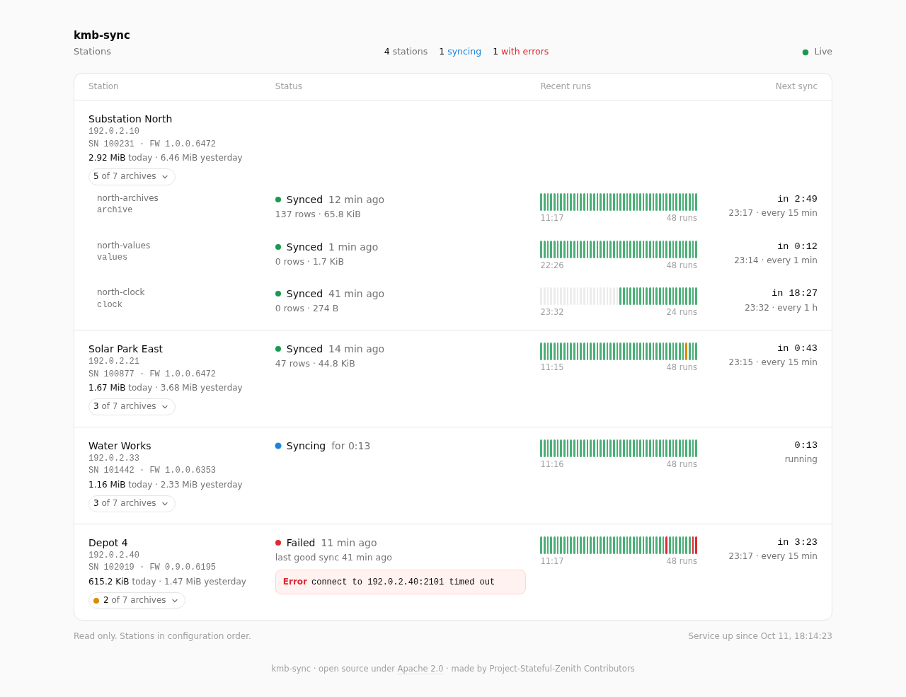
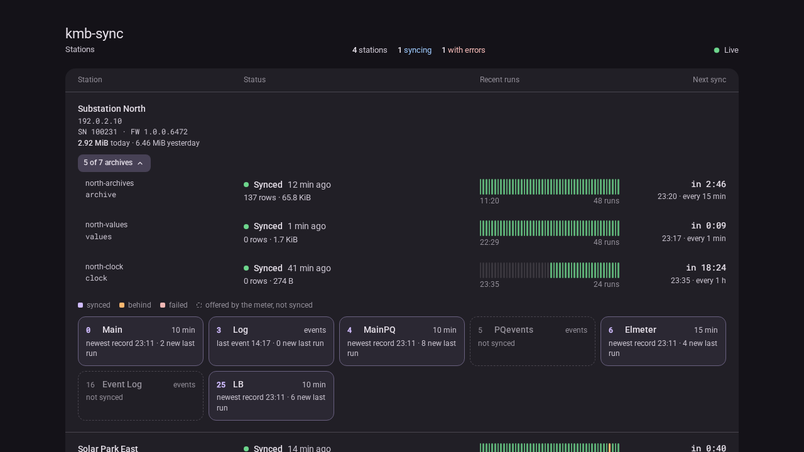
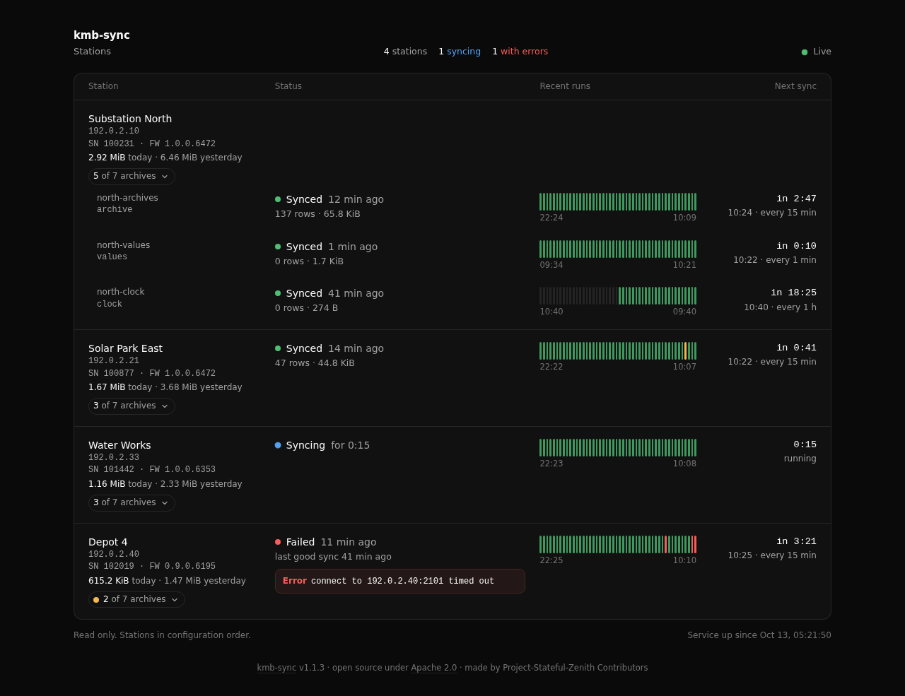
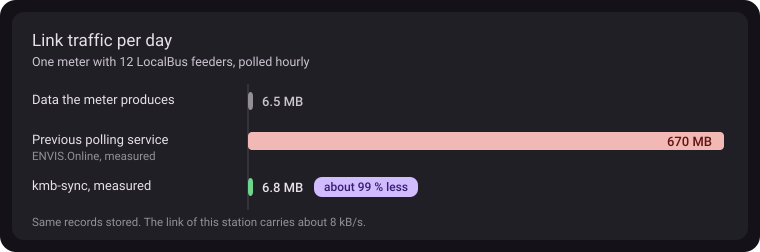

# kmb-sync

An always-on collector service for KMB/KMP meters (UMD-98 and other
universal-config meters). It polls meters on a schedule, stores their
archive records with the layout that decodes them, resumes after restarts
and outages, and offers a local JSON API, a status page and a command-line
client. It can also write the records into an ENVIS 2.5 MSSQL database.

| Crate | Contents |
| --- | --- |
| `kmb-store` | SQLite store: objects, identities, measurements, archive definitions, records, cursors, runs |
| `kmb-envis` | writes downloads into an ENVIS 2.5 MSSQL database |
| `kmb-sync` | the service (`serve`), one-shot runs (`once`), export and the API client commands |

The protocol comes from the `kmb` and `kmb-tokio` crates of
[zenith-kmb](https://github.com/Project-Stateful-Zenith/zenith-kmb), which
Cargo fetches from GitHub.

## Build

```sh
cargo build --release              # add --features tls for KMB over TLS
cargo test --workspace
```

## Use

```sh
kmb-sync check -c kmb-sync.toml   # validate the configuration
kmb-sync serve -c kmb-sync.toml   # run the service
kmb-sync status                   # ask the running service
kmb-sync --help
```

## Configuration

**[deploy/README.md](deploy/README.md)** explains every option: the
service, devices, the three job kinds, the ENVIS database, secret files and
value formats, plus installing with the systemd unit.

Ready-to-copy examples, all with made-up data:

| Example | Shows |
| --- | --- |
| [minimal.toml](deploy/examples/minimal.toml) | one meter with archive, values and clock jobs |
| [multi-station.toml](deploy/examples/multi-station.toml) | several meters, schedules and byte budgets |
| [secure-meter.toml](deploy/examples/secure-meter.toml) | TLS, encrypted links, logins, clock adjustment |
| [envis.toml](deploy/examples/envis.toml) | writing into an ENVIS database |
| [remote-api.toml](deploy/examples/remote-api.toml) | API and status JSON for other hosts, with tokens |

Check a configuration with `kmb-sync check -c FILE` before starting the
service.

## Status page

The service serves a read-only status page (`status_listen`, port 8651 in
the example configuration): every station with its jobs, the last 48 runs
between the time of the oldest shown and the latest poll, the next sync,
link bytes today and yesterday, and per-archive state. The footer shows the
running version. It follows the browser's light or dark setting.



<details>
<summary>Archive details and dark mode</summary>





</details>

The screenshots use made-up stations, addresses and serial numbers.

## Traffic

Meters often sit behind slow links: mobile data, radio, or a shared line of
a few kB/s. kmb-sync moves only what is new, so the link carries about what
the meter produces.



Measured on a UMD-98 with 12 LocalBus feeders, polled hourly over a line of
about 8 kB/s:

| | Per day | Compared with the meter's output |
| --- | --- | --- |
| Archive data the meter produces | ~6.5 MB | 1x |
| Previous polling service (ENVIS.Online) | ~670 MB | ~100x |
| **kmb-sync** | **~6.8 MB** | **~1.05x, about 99 % less than before** |

Both stored the same records: over a 30-hour window, 48,466 of 48,466 rows
written by kmb-sync were byte for byte equal to the ones the previous
service wrote. The difference is records sent again that were already
stored.

How kmb-sync keeps the link quiet:

- **Reads only new records.** Each archive resumes behind the newest record
  already stored, including archives that are stored per feeder.
- **A real byte budget.** `max_size` limits the bytes per schedule period,
  retries and manual runs included. Bytes are counted on the socket (TLS
  included) and each read is cut to fit, so a run stops within one record
  of its limit; the rest follows next period, never at once.
- **Timeouts count link time only.** A run waits for the meter first; its
  timeout starts when it holds the link, so the jobs of one meter cannot
  pile up.
- **Visible before and after.** `kmb-sync check` prints each meter's link
  share and the bytes per day its limits allow; `kmb-sync runs` and
  `kmb-sync traffic` show the bytes every run and every day actually took.

An hourly pass carries the hour's new records (~0.27 MB on the station
above) plus about 15 KB of fixed reads, about 35 s at 8 kB/s.

## Disclaimer

> [!WARNING]
> This project is an independent implementation, made for interoperability
> with meters and databases its users own or operate. The code was written
> from a separately prepared specification of the protocol and of the
> database layout. No vendor source code is contained in or was copied into
> this repository, and no vendor keys, certificates or product tables are
> included.
>
> This project is not affiliated with, endorsed by or supported by the
> manufacturers of the meters or of ENVIS. All product names and trademarks
> belong to their respective owners and are used only to identify the
> devices and software this project works with.
>
> The software is provided "as is", without warranty of any kind. Use it at
> your own risk, especially against production databases.

## License

Apache-2.0, see [LICENSE](LICENSE).
Copyright 2026 Project-Stateful-Zenith Contributors.
